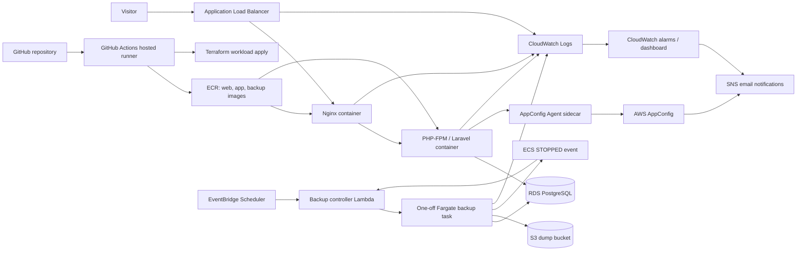

# Architecture and resource boundaries

This repository describes one deployable assessment environment in AWS Tokyo
(`ap-northeast-1`). It keeps cloud configuration in Terraform and runs image
builds on GitHub Actions. The application, backup program, and workflow are
versioned alongside the Terraform configuration.

## Terraform stacks

1. `bootstrap` creates the S3 backend used by subsequent Terraform stacks.
   Its local state must be kept securely because it owns the state bucket.
2. `foundation` owns resources whose lifecycle is independent of application
   releases: networking, ALB, RDS, ECR, ECS cluster, roles, AppConfig, SNS,
   log groups, ALB log delivery, and the application `ERROR` alarm used by
   AppConfig's rollback monitor. It publishes outputs consumed by the
   workload stack.
3. `workload` owns release-sensitive resources: ECS task definitions and
   service, scheduled task count, backup controller and schedule, dashboard,
   ALB log metric filters, and workload alarms. GitHub Actions builds immutable images,
   then supplies their references to a workload Terraform apply.

The stacks use separate Terraform states. The workflow serializes workload
applies so two releases cannot race to update the ECS service. Scheduled
scaling owns the service's desired task count after its initial creation.

## Network, cost, and availability choice

This short-lived assessment prioritizes low running cost over multi-AZ high
availability. RDS is a single-AZ `db.t4g.micro` with 20 GiB storage. The web
task is 0.25 vCPU / 0.5 GiB and usually has one replica; the one-off backup task
is 0.25 vCPU / 0.5 GiB. There is no RDS standby or automatic DB failover.

The load balancer requires subnets in two AZs and uses two public subnets.
This does not make the RDS instance Multi-AZ or the ordinary ECS service
two-replica. The database uses private subnets and a single RDS instance.
The Fargate task uses public subnets with a public
IP for outbound access to ECR, CloudWatch, and AppConfig; its security group
allows inbound HTTP only from the ALB security group. This avoids NAT gateway
or multiple VPC endpoint hourly charges in a short-lived assessment account.
The task's public IP does not create an open inbound application port. For a
long-lived production deployment, private tasks with controlled egress would
be preferable.

## Runtime data and releases

- The application receives fixed deployment values and secrets through the
  ECS task definition. The homepage displays only a designated non-secret
  demonstration variable.
- The AppConfig Agent in the task polls for configuration changes and serves
  them to Laravel over the task-local HTTP endpoint. AppConfig values are
  treated as dynamic configuration, so a release does not require changing
  process environment variables or baking values into an image.
- GitHub Actions runs on a GitHub-hosted ARM runner for `twink7e/aws-test`.
  AWS access keys are stored in repository Actions Secrets.
  The workflow builds the Docker images, pushes them to ECR,
  and runs Terraform for the workload stack with immutable image references.
  It waits for ECS service stability and checks the active task definition
  before reporting a successful release.
- The backup controller checks the ECS `RunTask` response, including a
  successful HTTP response containing a nonempty `Failures` array. The backup
  task produces a PostgreSQL custom-format full database dump with `pg_dump -Fc`,
  uploads it to S3, and exits unsuccessfully if creation or verification fails.
  An ECS `STOPPED` event returns to the controller for exit-code inspection.

## Observability

- Nginx emits JSON request logs including `X-Amzn-Trace-Id` to stdout.
  Laravel and PHP-FPM emit application and process logs to stderr/stdout.
- ECS `awslogs` sends container streams to CloudWatch log groups. The ALB
  sends access logs directly to CloudWatch Logs as vended logs.
- CloudWatch metric filters count application `ERROR` entries and ALB access
  records with status `500`. Metric math computes the 500 share from the same
  access-log stream. ECS Container Insights supplies desired and running task
  counts for the dashboard.
- AppConfig's EventBridge deployment extension sends completion and rollback
  events to SNS. Its application `ERROR` alarm can automatically roll back a
  gradual configuration deployment.
- Scheduler target, controller Lambda and EventBridge delivery errors have
  separate CloudWatch alarms. A dedicated backup metric records task failure.
- SNS sends failure alerts and release notifications to confirmed email
  subscriptions. All relevant log groups have a finite retention period.

The implementation details and operator commands are in
[`runbook.md`](runbook.md). The repository file inventory is in the root
[`README.md`](../README.md).
